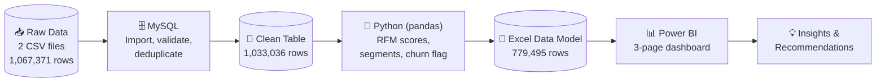

<div align="center">


### From 1M+ raw transactions to a decision-ready customer dashboard


</div>

---

## 🧭 Quick Links for Recruiters

> Short on time? Everything you need is one click away.

| 📁 What | 🔗 Open | What you will see |
|---|---|---|
| 📊 **Power BI Dashboard** | [`06_Dashboard/Ikea_Dashboard.pbix`](https://github.com/DarshChoudhary-09/End-to-End-Project/blob/main/Screenshot%202026-10-30%20223554.png) · [Screenshots](#dashboard) | 3-page interactive report with slicers, toggles and drill-down |
| 🗄️ **SQL Code** | [`03_SQL/IKEA_SQL_Code.sql`](https://github.com/DarshChoudhary-09/End-to-End-Project/blob/main/IKEA%20SQL%20Code.sql) · [SQL walkthrough](#sql) | Import, validation, deduplication of 1M+ rows in MySQL |
| 🐍 **Python Notebook** | [`04_Python/Online_retail.ipynb`](https://github.com/DarshChoudhary-09/End-to-End-Project/blob/main/Online_retail_Pyhton_Code.ipynb) · [Python walkthrough](#python) | RFM scoring, segmentation and churn flag in pandas |
| 📗 **Excel Data Model** | [`05_Excel/EcommerceDashboardData.xlsx`](https://github.com/DarshChoudhary-09/End-to-End-Project/blob/main/Online_Retail_Raw_Data.zip) · [Data dictionary](#excel) | Final analysis-ready dataset that feeds the dashboard |
| 🧹 **Cleaned Dataset** | [`02_Data/online_retail_clean.zip`](https://github.com/DarshChoudhary-09/End-to-End-Project/blob/main/online_retail_clean.zip) | Deduplicated transactions exported from MySQL |

**Open the notebook directly in Google Colab:**
[](https://github.com/DarshChoudhary-09/End-to-End-Project/blob/main/Online_retail_Pyhton_Code.ipynb)

---

## 📑 Table of Contents

1. [Project at a Glance](#at-a-glance)
2. [Business Problem](#business-problem)
3. [Key Findings](#key-findings)
4. [Dashboard](#dashboard)
5. [Project Workflow](#workflow)
6. [SQL: Data Cleaning](#sql)
7. [Python: RFM Segmentation](#python)
8. [Excel: Data Model](#excel)
9. [Recommended Actions by Segment](#actions)
10. [Challenges I Solved](#challenges)
11. [Repository Structure](#structure)
12. [How to Reproduce](#reproduce)
13. [About Me](#about)

---

<a id="at-a-glance"></a>
## 🎯 Project at a Glance

<div align="center">

| 👥 Customers Analysed | 💰 Revenue Analysed | 📉 Churn Rate | 💎 Avg Customer Value |
|:---:|:---:|:---:|:---:|
| **5,881** | **$17.4M** | **50.86%** | **$2,954** |

| 🧾 Raw Rows | 🧹 Clean Rows | 🌍 Countries | 📅 Period |
|:---:|:---:|:---:|:---:|
| **1,067,371** | **1,033,036** | **41** | **Dec 2009 – Dec 2011** |

</div>

**In one sentence:** I cleaned two years of retail transactions in SQL, scored every customer on Recency, Frequency and Monetary value in Python, and built an interactive Power BI dashboard that shows which customers drive revenue and which are slipping away.

---

<a id="business-problem"></a>
## 💼 Business Problem

IKEA Gifting is framed as a UK-based, online-only retailer of gift ware and home décor, where a meaningful share of buyers are wholesale customers. Leadership had **no structured view** of which customers generate the most revenue or which show early signs of disengagement, so retention and marketing spend was reactive and not prioritised by customer value.

**Objective:** identify the most valuable customer segments and quantify churn risk, so Marketing, CRM and Retention teams can target effort where it matters most.

**Business questions answered**

1. Who are the most valuable customers, and how much revenue do they contribute?
2. Which customers have gone quiet and are at risk of churning?
3. How do customer value and retention trend by month, quarter and year?
4. How do value and churn differ across countries?
5. What concrete action should the business take for each segment?


| Term | Definition |
|---|---|
| **Recency (R)** | Days since the customer's most recent purchase (snapshot date: 10 Dec 2011) |
| **Frequency (F)** | Number of distinct invoices |
| **Monetary (M)** | Total revenue per customer (quantity × unit price) |
| **Churn** | No purchase in the trailing **90 days** |

> **Scope:** SQL cleaning, Python RFM segmentation, a fixed-threshold churn flag and a multi-page Power BI dashboard. Predictive churn modelling and campaign execution are out of scope.

---

<a id="key-findings"></a>
## 🔍 Key Findings

> All figures below are calculated from the 5,881 customers with a Customer ID and at least one purchase.

| Segment | Customers | % of Customers | Revenue | % of Revenue | Avg Customer Value |
|---|---:|---:|---:|---:|---:|
| 🏆 **Champions** | 1,291 | 22.0% | $11.84M | **68.1%** | $9,169 |
| 💙 **Loyal** | 1,416 | 24.1% | $2.70M | 15.5% | $1,908 |
| ⚠️ **At Risk** | 821 | 14.0% | $1.59M | 9.1% | $1,932 |
| 💤 **Lost** | 1,524 | 25.9% | $0.65M | 3.8% | $429 |
| 🌱 **New** | 442 | 7.5% | $0.39M | 2.3% | $887 |
| 👀 **Needs Attention** | 387 | 6.6% | $0.20M | 1.2% | $529 |

**What the data says**

- 🏆 **22% of customers generate 68% of revenue.** Champions are worth about **21× more** than Lost customers ($9,169 vs $429 each).
- ⚠️ **At Risk customers are as valuable as Loyal ones** ($1,932 vs $1,908 average), but they have gone quiet. That is **$1.59M of revenue** worth a targeted win-back effort.
- 📉 **More than half (50.86%) of customers are flagged as churned** under the 90-day rule, so retention is a major lever.
- 🌍 **The United Kingdom accounts for about 83% of revenue**, so the other 40 markets are small and individually volatile.

---

<a id="dashboard"></a>
## 📊 Dashboard

📂 **File:** [`06_Dashboard/Ikea_Dashboard.pbix`](https://github.com/DarshChoudhary-09/End-to-End-Project/blob/main/Ikea%20Dashboard.pbix) (open with the free [Power BI Desktop](https://powerbi.microsoft.com/desktop/))

The report has three pages: **Home** (navigation), **Business Overview** and **RFM Analysis**.

### Business Overview
<div align="center">

</div>

### RFM Analysis
<div align="center">

</div>

**Interactive features**

- 🎛️ **Six slicers:** Month, Quarter, Year, Country, Segment and Is Churned
- 🔁 **Revenue / Customer toggle** that switches the charts between revenue and customer counts (disconnected table + `SWITCH` measure)
- 🔀 **Segment / Country toggle** that swaps the chart axis (Power BI field parameter)
- 🧹 **Clear all slicers** button and a **back-navigation** button
- 📈 Trend views of churn by **month, quarter and year**
- 🧮 **Segment Performance Summary** table: customers, revenue, average R / F / M scores

<details>
<summary><b>📐 DAX measures used (click to expand)</b></summary>

```dax
Churned % =
DIVIDE(
    CALCULATE(
        DISTINCTCOUNT('Sheet1'[Customer_ID]),
        'Sheet1'[IsChurned] = TRUE()
    ),
    DISTINCTCOUNT('Sheet1'[Customer_ID])
)

Selected View = SELECTEDVALUE('View Toggle'[View], "Revenue")

Dynamic Metric =
SWITCH(
    [Selected View],
    "Revenue",  [Total Revenue],
    "Customer", [Total Customer],
    [Total Revenue]
)
```

</details>

---

<a id="workflow"></a>
## 🔄 Project Workflow



| Step | Tool | Output |
|---|---|---|
| 1. Requirements | Word (BRD) | Objectives, scope, definitions |
| 2. Import & clean | MySQL Workbench | Deduplicated transaction table |
| 3. Segment | Python (pandas) in Google Colab | RFM scores, segments, churn flag |
| 4. Model | Excel | Analysis-ready dataset |
| 5. Visualise | Power BI | Interactive dashboard |

---

<a id="sql"></a>
## 🗄️ SQL: Data Cleaning

📂 **File:** [`03_SQL/IKEA_SQL_Code.sql`](./03_SQL/IKEA_SQL_Code.sql)

| Stage | What I did | Result |
|---|---|---|
| **Import** | Loaded both yearly CSV files with `LOAD DATA LOCAL INFILE`, converting `dd-mm-yyyy` text into real `DATETIME` values with `STR_TO_DATE`, and storing blank Customer IDs as `NULL` with `NULLIF` | 541,910 + 525,461 rows |
| **Combine** | Found that the two files **overlap by 9 days** (1–9 Dec 2010) and merged them with `UNION ALL`, keeping each day once | 1,044,848 rows |
| **Validate** | Checked missing customer IDs, missing descriptions, negative or zero quantities, null dates and null prices | Data-quality profile |
| **Deduplicate** | Removed exact duplicate rows (same invoice, product, quantity, timestamp, price, customer and country) while keeping one copy | 11,812 duplicates removed |
| **Verify** | Re-ran the duplicate check on the clean table | **0** duplicate groups remain |

**Techniques shown:** `GROUP BY` / `HAVING`, subqueries, `UNION ALL`, `NULLIF`, `STR_TO_DATE`, `ROW_NUMBER() OVER (PARTITION BY …)`, chunked deduplication with `MIN(RowID)`, primary keys, `CREATE TABLE … LIKE`.

---

<a id="python"></a>
## 🐍 Python: RFM Segmentation

📂 **File:** [`04_Python/Online_retail.ipynb`](./04_Python/Online_retail.ipynb)
[](https://colab.research.google.com/github/YOUR-USERNAME/ikea-gifting-customer-analytics/blob/main/04_Python/Online_retail.ipynb)

**Steps in the notebook**

1. Load the cleaned CSV and convert types (dates, numbers, nullable integer `Customer_ID`)
2. Keep rows with a Customer ID and a positive quantity (removes returns and anonymous orders)
3. Calculate **Recency, Frequency, Monetary** per customer against a snapshot date of **10 Dec 2011**
4. Score each metric **1 to 5** with `pd.qcut` (quintiles)
5. Assign **business segments** with rule-based logic
6. Flag churn (`Recency > 90 days`)
7. Merge results back into the transaction data and export to Excel

```python
def segment_customer(row):
    if row['R_Score'] >= 4 and row['F_Score'] >= 4 and row['M_Score'] >= 4:
        return 'Champions'
    elif row['R_Score'] >= 3 and row['F_Score'] >= 3:
        return 'Loyal'
    elif row['R_Score'] <= 2 and row['F_Score'] >= 3:
        return 'At Risk'
    elif row['R_Score'] >= 4 and row['F_Score'] <= 2:
        return 'New'
    elif row['R_Score'] == 3 and row['F_Score'] <= 2:
        return 'Needs Attention'
    else:
        return 'Lost'
```

> **Why `rank(method='first')` on Frequency?** Many customers have exactly one order, so quintile cut-points repeat and `qcut` fails. Ranking first breaks ties and keeps five equal-sized groups.

---

<a id="excel"></a>
## 📗 Excel: Data Model

📂 **File:** [`05_Excel/EcommerceDashboardData.xlsx`](./05_Excel/EcommerceDashboardData.xlsx)

The final dataset that feeds the Power BI report: **779,495 transaction rows × 18 columns**, with customer-level RFM results merged onto every transaction.

<details>
<summary><b>📖 Data dictionary (click to expand)</b></summary>

| Column | Description |
|---|---|
| `Invoice` | Invoice number (a leading **C** marks a cancellation) |
| `StockCode` | Product code |
| `Description` | Product name |
| `Quantity` | Units purchased |
| `InvoiceDate` | Date and time of the invoice |
| `Price` | Unit price |
| `Customer_ID` | Unique customer identifier |
| `Country` | Customer country |
| `InvoiceMonth` | First day of the invoice month (used for trend charts) |
| `Revenue` | `Quantity × Price` |
| `RECENCY` | Days since the customer's last purchase |
| `FREQUENCY` | Distinct invoices per customer |
| `MONETARY` | Total spend per customer |
| `R_Score`, `F_Score`, `M_Score` | Quintile scores from 1 (worst) to 5 (best) |
| `Segment` | Champions, Loyal, At Risk, New, Needs Attention or Lost |
| `IsChurned` | `TRUE` when Recency is above 90 days |

</details>

---

<a id="actions"></a>
## 🎯 Recommended Actions by Segment

> These are my recommendations based on the segment profiles. They are not tested campaign results.

| Segment | Goal | Suggested action |
|---|---|---|
| 🏆 **Champions** | Protect | VIP perks, early access to new ranges, dedicated account contact |
| 💙 **Loyal** | Grow | Cross-sell and bundle offers, loyalty programme to lift order value |
| ⚠️ **At Risk** | Win back | Personalised "we miss you" outreach before they lapse fully, since their value is comparable to Loyal customers |
| 🌱 **New** | Convert | Welcome series and a second-order incentive |
| 👀 **Needs Attention** | Re-engage | Reminders around seasonal gifting moments, low-cost nudges |
| 💤 **Lost** | Decide | Low-cost win-back test only, avoid heavy spend (average value is $429) |

---

<a id="challenges"></a>
## 🧩 Challenges I Solved

| Problem | Cause | Fix |
|---|---|---|
| Import error 1366 on `Customer ID` | Blank values cannot go into an `INT` column | Imported blanks as `NULL` using `NULLIF(@cust, '')` |
| `Invalid utf8mb4 character` error (1300) | CSV saved in Windows-1252 encoding | Added `CHARACTER SET latin1` to `LOAD DATA` |
| Dates imported wrongly | Source dates are `dd-mm-yyyy`, not month-first | Parsed with `STR_TO_DATE(@dt, '%d-%m-%Y %H:%i')` |
| Import ran for hours | Row-by-row insert through the import wizard | Switched to `LOAD DATA`, which loads about 540K rows in seconds |
| Double-counted revenue | The two yearly files overlap by 9 days | Kept each overlapping day from one file only |
| Deduplication timed out | Window function over 1M+ rows exceeded the client timeout | Rebuilt it with a date-chunked `GROUP BY` and `MIN(RowID)` |
| Python columns shifted | MySQL escapes commas in descriptions with `\` | Read the file with `escapechar='\\'` in pandas |
| `qcut` failed on Frequency | Many customers share the same order count | Ranked with `method='first'` before cutting |

---

<a id="structure"></a>
## 🗂️ Repository Structure

```text
ikea-gifting-customer-analytics/
│
├── README.md
│
├── 01_Business_Requirements/
│   └── IKEA_Gifting_BRD.docx
│
├── 02_Data/
│   ├── raw/
│   │   ├── online_retail_II_page_1.csv
│   │   └── online_retail_II_page_2.csv
│   └── online_retail_clean.zip
│
├── 03_SQL/
│   └── IKEA_SQL_Code.sql
│
├── 04_Python/
│   └── Online_retail.ipynb
│
├── 05_Excel/
│   └── EcommerceDashboardData.xlsx
│
├── 06_Dashboard/
│   └── Ikea_Dashboard.pbix
│
└── images/
    ├── dashboard-business-overview.png
    └── dashboard-rfm-analysis.png
```

---

<a id="reproduce"></a>
## ▶️ How to Reproduce

1. **Get the data.** Download *Online Retail II* from the [UCI Machine Learning Repository](https://archive.ics.uci.edu/dataset/502/online+retail+ii), or use the copies in [`02_Data/`](./02_Data/).
2. **Run the SQL.** Open [`IKEA_SQL_Code.sql`](./03_SQL/IKEA_SQL_Code.sql) in MySQL Workbench, change the file paths in the `LOAD DATA` statements to your own, and run the sections in order.
3. **Export the clean table** to CSV from MySQL, or unzip [`online_retail_clean.zip`](./02_Data/online_retail_clean.zip).
4. **Run the notebook.** Open [`Online_retail.ipynb`](./04_Python/Online_retail.ipynb) in Colab, upload the clean CSV, and run all cells. It writes `EcommerceDashboardData.xlsx`.
5. **Open the dashboard.** Open [`Ikea_Dashboard.pbix`](./06_Dashboard/Ikea_Dashboard.pbix) in Power BI Desktop and refresh the data source to point at your Excel file.

**Requirements:** MySQL 8.0+, Python 3.10+ with `pandas` and `openpyxl`, Power BI Desktop.

---

## ⚠️ Limitations

- Churn uses a **fixed 90-day rule** for simplicity and interpretability, not a statistically derived cutoff.
- About **23% of cleaned rows have no Customer ID** and are excluded from the RFM analysis.
- **Wholesale and retail buyers are not separated**, so some high-value customers may be businesses.
- The analysis uses **historical transactions only** and does not account for promotions or seasonality drivers.

---

<a id="about"></a>
## 👤 About Me

**Darsh Choudhary**: recent B.Tech graduate in Automation and Robotics (2026), based in New Delhi, targeting **Data Analyst** and **Data Scientist** roles. Google Data Analytics Certified, with hands-on skills in **SQL, Python, Excel and Power BI**.

[](https://www.linkedin.com/in/darsh-choudhary-4a7563238/)
[](https://github.com/DarshChoudhary-09)
[](mailto:choudharydarsh56@gmail.com)

---

## 🙏 Acknowledgements

- **Data:** *Online Retail II* dataset from the UCI Machine Learning Repository, donated by Daqing Chen.
- **Disclaimer:** this is an independent educational case study. The IKEA name and colours are used for case-study framing only, and the project has no affiliation with or endorsement from IKEA.

<div align="center">

⭐ **If you found this project useful, please consider giving it a star.** ⭐


</div>
